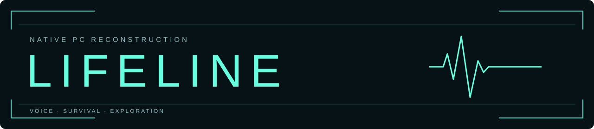
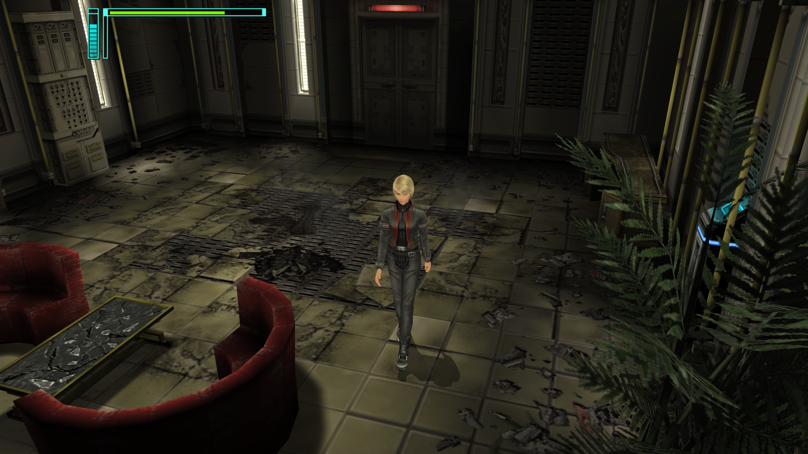
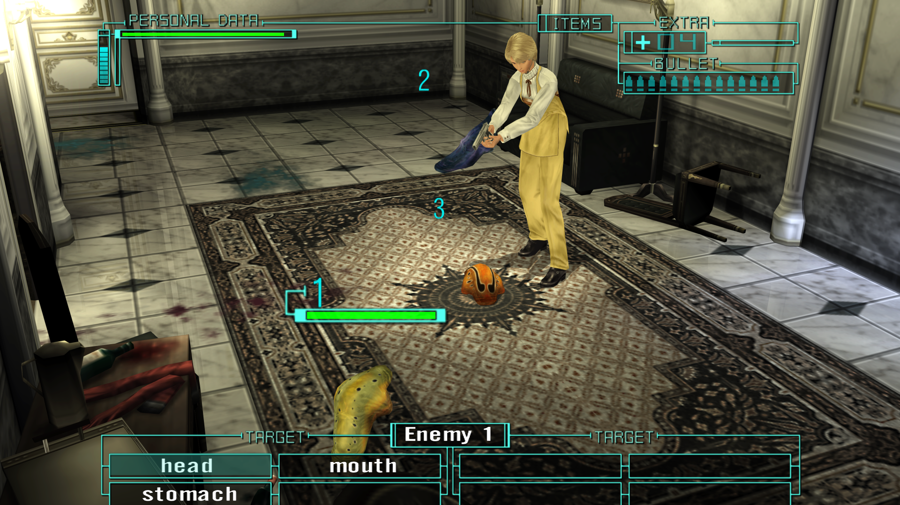
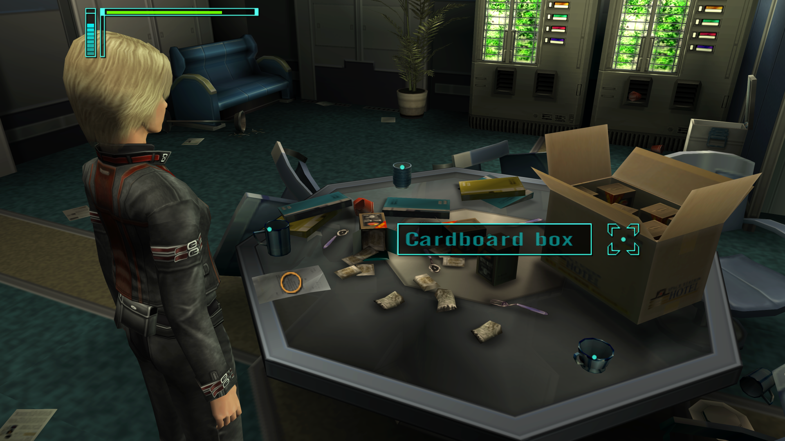
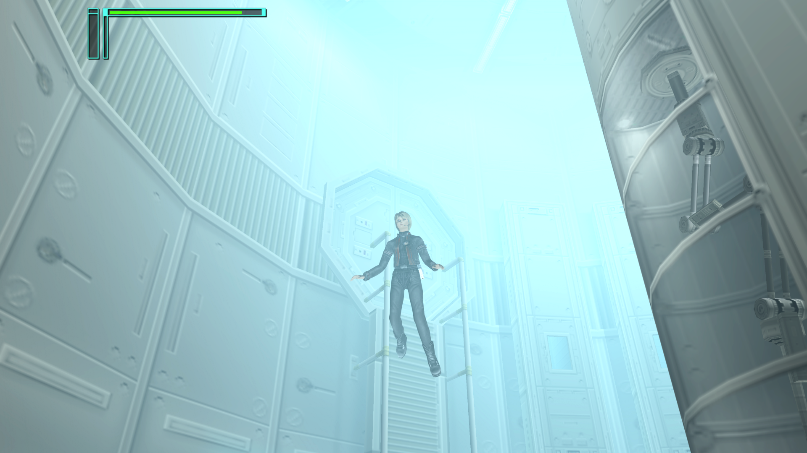

  

Your voice is Rio's lifeline. Explore, investigate, and survive on Windows.

  <a href="#screenshots">Screenshots</a> ·
  <a href="#features">Features</a> ·
  <a href="#build">Build</a> ·
  <a href="#installation">Install</a> ·
  <a href="#controls">Controls</a> ·
  <a href="#settings">Settings</a> ·
  <a href="#credits">Credits</a>

An unofficial native PC reconstruction of **Lifeline / Operator's Side**.
Guide Rio through a space hotel using spoken commands, examine her surroundings,
and direct her during combat. The Windows version adds configurable controls,
display options, and audio settings around the original game.

This repository contains the source code to build the game and its installer.
You need your own North American **SLUS_208.48** Lifeline ISO to install and play.
Game data and disc images are not included.

## Screenshots

Fresh captures from saved games, rendered with Direct3D 12 using
the Modern visual style. Click an image to see it at full size.

| Exploration | Combat |
| :---: | :---: |
|  |  |
| **Investigation** | **Later-game scenes** |
|  |  |

- Voice commands processed locally with the original game's speech models.
- Direct3D 12 rendering, with a software renderer available.
- Windowed, borderless, and fullscreen display; 4:3, 16:9, or automatic aspect ratios.
- Adjustable render scale, texture filtering, shadows, reflections, and FXAA.
- Five visual styles, including Original and Modern.
- Rebindable keyboard, gamepad, and joystick controls with matching on-screen prompts.
- Playback and microphone selection, a live microphone meter, and separate movie, dialogue, and music volumes.
- Hold Confirm for five seconds to skip a movie, with an on-screen progress indicator.
- Native saves stored beside the installed game.

Use **64-bit Windows 10 or 11** with:

- Visual Studio or Visual Studio Build Tools, including **Desktop development with C++**, x64 MSVC, and a Windows SDK.
- Git for Windows, including Bash, available on PATH.
- Windows PowerShell, `curl.exe`, and `certutil.exe`.

1. Clone this repository, or download and extract its source ZIP.
2. Run **[build-installer.bat](build-installer.bat)** from the repository root.
3. Find the completed installer at **`build/Installer.exe`**.

The batch file fetches verified build dependencies, compiles the native game,
and embeds it in the installer. The first build requires internet access.
You do not need the game ISO until installation.

Run `build-installer.bat --no-pause` from a terminal to omit the final key prompt.

1. Run your built **`Installer.exe`**.
2. Select your **SLUS_208.48 Lifeline ISO**.
3. Choose a writable installation folder and complete the conversion.
4. Launch **`lifeline.exe`** from that folder.

Keep the installed `data/` folder beside the executable. Saves and settings live
in `user/` beside it. The installer converts your disc's resources and movies
locally; it does not download game content.

| Action | Keyboard | Controller |
| --- | --- | --- |
| Navigate menus and panels | **Arrow keys** | **D-pad** |
| Speak | Hold **T**, talk, then release | Hold **RB / R1**, talk, then release |
| Confirm / operate | **Enter** | **A / Cross** |
| Back / close | **Escape** | **B / Circle** |
| Pause | **P** | **Start** |
| Map | **M** | **LB / L1** |
| Items | **I** | **LT / L2** |
| Keywords | **K** | **RT / R2** |

Change bindings in **Options → Controls**. During play, pause and select
**Settings** to adjust controls, display, graphics, audio, or microphone settings.

For movies, hold the configured **Confirm** input for **five seconds**. A progress
bar appears in the bottom-right corner. Release before skipping another movie.

Hold Speak while talking, then release it to submit the command. Speech
recognition runs locally. Conversations and actions can temporarily disable input.
Escape also pauses when no panel has priority and the game allows pausing.

To rebind an action, select its Keyboard or Joystick column in Controls, press
Enter, then use the desired input. Escape cancels capture; Delete clears a binding.
Assigning an input already in use swaps the two assignments. On-screen prompts
follow the saved bindings and the input device you last used.

### Settings

Open **Options** from the title screen, or **Pause → Settings** during play.
Changes save immediately. Each page's **Restore Defaults** affects that page.

| Page | Options |
| --- | --- |
| Audio | Playback device, Stereo/Mono output, and separate FMV, Dialogue, and Music volumes. Volume changes play a short preview. |
| Controls | Keyboard, gamepad, and joystick bindings. |
| Display | Windowed, Borderless, or Fullscreen; resolution, VSync, and 4:3, 16:9, or Auto aspect ratio. |
| Graphics | Quality presets, render scale, FXAA, texture quality/filtering, shadow quality, Off/Low/High reflections, and visual style. |
| Microphone | Recording device, a live Input Level meter, and numeric gain from 0% to 200%. Speak normally to check the level; lower gain if Too Loud appears. |

The default display mode is Borderless with a centered 4:3 view. Original,
Faithful, Balanced, Modern, and Enhanced visual styles are available. Gameplay
stays paused while using Settings; graphics changes are visible behind the panel.

System default follows the operating system's audio device choice. If a preferred
device is disconnected, the game remembers it and temporarily uses the default.
Changing the microphone or gain cancels the current utterance; release Speak
before recording another command. The Input Level bar measures incoming sound.

Settings are stored in `user/config.ini` beside `lifeline.exe`; output mode and
bindings are in `user/menu-settings.txt`. Use the menus to select audio devices.
Close the game before making manual configuration edits.

This is an unofficial project and is not affiliated with or endorsed by the
original game's developers or publishers. Lifeline / Operator's Side, its
characters, artwork, and trademarks belong to their respective owners.
Screenshots illustrate the game and do not change ownership of its content.

Third-party components retain their respective licenses:

- **SDL 3.4.12** — [zlib license](docs/third-party/SDL-LICENSE.txt).
- **FFmpeg 8.1.3** — [LGPL 2.1](docs/third-party/FFmpeg-LGPL-2.1.txt). The installer uses minimal static libraries for local movie conversion.
- **JSON for Modern C++ 3.12.0** — MIT; see the [third-party notices](project/installer/packaging/third-party-notices.txt).

The installer includes the third-party license texts and notices with the
installed program. Build tools retain the licenses in their downloaded archives.
